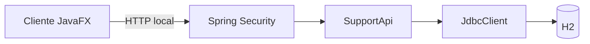

# Seguridad de APIs en una mesa de soporte

**Proyecto individual · Arquitectura de Software · 21 de noviembre de 2026**

## 1. Introducción

### Descripción general y objetivo

**Mesa de Soporte** es una aplicación de escritorio para registrar usuarios, abrir tickets y conversar con un agente de soporte. El objetivo del prototipo es demostrar cómo la API autentica al solicitante y comprueba sus permisos para cada operación y cada ticket.

### Alcance y tecnologías

La demostración cubre autenticación, autorización por rol y por recurso, validación de datos, protección de sesión y gestión de avisos en dependencias. Se usaron datos ficticios en una instancia local con H2 en memoria. [Versión evaluada del proyecto](https://github.com/angelloaroni/SeguridadApisAroni/tree/f1099fbaa059cbadfd468e23d5e069a7a82fa8bf)

| Tecnología | Uso |
| --- | --- |
| Java 21, JavaFX y Maven | Interfaz de escritorio y construcción de los módulos. |
| Java HttpClient | Solicitudes HTTP y gestión de la cookie de sesión en el cliente. |
| Spring Boot y Spring Security | API REST, autenticación, sesiones y autorización por ruta. |
| Spring JDBC y H2 | Consultas parametrizadas y almacenamiento de cuentas, tickets y mensajes. |
| Springdoc | Generación de OpenAPI y visualización en Swagger UI. |

## 2. Problema

Una mesa de soporte recibe datos de cuenta y conversaciones privadas. Tener una cuenta válida permite entrar al sistema, pero el servidor todavía debe comprobar si esa persona puede ver un ticket concreto o realizar una acción reservada para cierto rol. Además, el proyecto incorpora dependencias de terceros cuyos avisos deben revisarse a medida que se publican.

| Escenario | Resultado esperado |
| --- | --- |
| Consulta sin sesión o con sesión cerrada | Se solicita autenticación. |
| Consulta de un ticket por otro usuario | Se deniega el acceso al ticket. |
| Respuesta del agente asignado | Se agrega el mensaje a la conversación. |
| Actualización de una dependencia con un aviso | Se repite el análisis y se verifica que el flujo siga funcionando. |

## 3. Solución propuesta

1. El usuario se registra, inicia sesión y crea un ticket desde JavaFX.
2. El servidor determina quién es el propietario a partir de la sesión. Si la cuenta de agente ya existe, le asigna el ticket.
3. El propietario y el agente asignado pueden ver y responder la conversación. Otro usuario recibe `404` al solicitar ese ticket.
4. El cierre de sesión invalida la sesión. Los accesos siguientes a rutas privadas requieren iniciar sesión de nuevo.

## 4. Arquitectura del sistema

El proyecto sigue una arquitectura cliente-servidor. El cliente de escritorio está en `frontend/` y la API REST monolítica de Spring Boot está en `backend/`. Spring Security verifica la sesión, el token CSRF y los permisos por ruta. `SupportApi` concentra las reglas de negocio y las consultas SQL. `JdbcClient` ejecuta esas consultas contra H2.

La separación cliente-servidor ubica la decisión de acceso en la API y permite evaluar el mismo contrato con distintos clientes HTTP. H2 funciona en modo archivo al ejecutar el proyecto y en memoria durante las pruebas de este informe.

## 5. Diseño e implementación

### Controles de seguridad

| Control | Implementación |
| --- | --- |
| Contraseñas | Hash BCrypt con factor de costo 12. |
| Sesión | Cookie `JSESSIONID` con `HttpOnly` y `SameSite=Strict`. Se configura una expiración por inactividad de 20 minutos. |
| Autorización por rol | La creación de tickets requiere el rol `USER`. |
| Autorización por recurso | La API filtra los tickets por propietario o agente asignado. |
| Validación | Los DTO definen campos, tipos y límites. El perfil permite editar el nombre visible. |
| CSRF | El cliente obtiene un token asociado a la sesión para las operaciones de escritura. |
| Transporte | HTTP de desarrollo en `127.0.0.1`. Para una red externa, el despliegue requiere HTTPS y una cookie con el atributo `Secure`. |

### Modelo de datos

| Tabla | Responsabilidad |
| --- | --- |
| `accounts` | Guarda el nombre de usuario, el nombre visible, el hash de contraseña y el rol. |
| `tickets` | Guarda el asunto, el propietario y el agente asignado. |
| `messages` | Vincula cada mensaje con su ticket, autor y fecha de creación. |

### API REST

| Método y ruta | Regla de acceso |
| --- | --- |
| `GET /api/csrf` | Emite el token CSRF para la sesión. |
| `POST /api/register`, `POST /api/login` | Rutas públicas que requieren token CSRF. |
| `POST /api/logout` | Recibe el token CSRF e invalida la sesión. |
| `GET /api/profile`, `PATCH /api/profile` | Devuelven o actualizan el perfil de la sesión activa. |
| `GET /api/tickets` | Devuelve los tickets del propietario o asignados al agente. |
| `POST /api/tickets` | Crea un ticket con el rol `USER`. |
| `GET /api/tickets/{id}`, `POST /api/tickets/{id}/messages` | Requieren ser el propietario o el agente asignado. |

## 6. Demostración

1. Con JDK 21, abre las dos carpetas como proyectos Maven en NetBeans. Ejecuta `spring-boot:run` en el backend y `javafx:run` en el frontend. Para la demo con agente, configura `SUPPORT_AGENT_PASSWORD` antes de crear el primer ticket. [Guía de ejecución](README.md)
2. Registra dos cuentas ficticias. Crea un ticket con la primera, abre la lista con la segunda y comprueba que su lista no contiene el ticket de la primera.
3. Entra como `agente`, responde y vuelve a la primera cuenta para ver la conversación actualizada.
4. Presenta el caso de Commons Lang como un ciclo de gestión, desde el descubrimiento del aviso hasta la actualización y la verificación posterior.

Para consultar el contrato cuando la API esté en ejecución, usa `http://127.0.0.1:8080/v3/api-docs`. Los proyectos Maven pueden abrirse y ejecutarse por separado desde el mismo repositorio.

## 7. Resultados

| Herramienta | Estado y alcance |
| --- | --- |
| Cliente HTTP de Python | **Ejecutado.** 21 comprobaciones de la API pasaron con tres sesiones independientes. Se validaron códigos HTTP, campos de respuesta y atributos de la cookie. |
| curl | **Ejecutado.** Una solicitud local a `GET /api/profile` mostró una conexión a `127.0.0.1` por HTTP/1.1 y recibió `401` sin sesión. |
| Redocly CLI 2.82.0 | **Ejecutado.** Analizó el OpenAPI 3.1 generado por Springdoc con el conjunto de reglas `recommended`. Reportó 10 errores y 9 advertencias. |
| OSV Scanner 2.7.1 | **Ejecutado.** Consultó avisos conocidos para las dependencias de ejecución de ambos módulos, incluidas las transitivas resueltas por Maven. |
| TShark 4.6.4 (Wireshark) | **Ejecutado.** Capturó dos intercambios HTTP en loopback dentro de un contenedor aislado. El resultado conservó método, ruta y estado. |
| 42Crunch | **Intentado.** Se generó un contrato OpenAPI 3.0.1 para probar la edición Freemium. Se descargó su imagen oficial, pero Docker agotó el espacio disponible al iniciar el contenedor. Quedó pendiente el informe del producto. |
| Salt Security | **Pendiente.** La evaluación de monitoreo en ejecución requiere una instancia de Salt y una fuente de tráfico integrada. El entorno carecía de esa integración. |

### Comprobaciones funcionales

| Caso | Evidencia observada |
| --- | --- |
| Autenticación | Perfil sin sesión `401`, registro de ambos usuarios `201`, nombre duplicado `409`, contraseña incorrecta `401` y tres inicios de sesión válidos `204`. |
| Sesión y CSRF | `HttpOnly` y `SameSite=Strict` presentes en la cookie del inicio de sesión. Registro sin token `403`. Cierre de sesión `204` y acceso posterior al perfil `401`. |
| Perfil | Consulta y actualización del nombre `200`. La consulta solo devolvió usuario, nombre visible y rol. Un cuerpo con un campo ajeno al esquema recibió `400`. |
| Autorización | Creación y asignación del ticket `201`, lectura del propietario `200`, lista vacía para el segundo usuario `200` y consulta del ticket ajeno `404`. Crear un ticket con rol agente recibió `403`. |
| Mensajería | El agente asignado respondió con `201`. La propietaria volvió a consultar y vio los dos mensajes con sus respectivos autores `200`. |

### Observación del tráfico con Wireshark

| Solicitud observada | Respuesta capturada |
| --- | --- |
| `GET /api/profile` sin sesión | `401` |
| `GET /v3/api-docs` | `200` |

La captura de TShark confirmó que se podían leer el método, la ruta y el estado HTTP en el transporte local de desarrollo. La prueba usó dos peticiones sin credenciales. Para un despliegue en red, la configuración de HTTPS requiere una verificación aparte. [Manual de TShark](https://www.wireshark.org/docs/man-pages/tshark.html)

### Revisión del contrato OpenAPI

Ocho operaciones carecían de resumen y ocho omitían documentar respuestas `4xx`. Además, `GET /api/csrf` y `POST /api/register` carecían de una declaración explícita de seguridad en el contrato. Son rutas públicas por diseño y la prueba de registro confirmó que la escritura sigue exigiendo CSRF. La advertencia restante corresponde a los metadatos de licencia. El inicio y el cierre de sesión se implementan mediante filtros de Spring Security y actualmente se describen en el README.

La mejora propuesta es documentar las respuestas `401`, `403`, `404` o `400` donde correspondan y declarar explícitamente cuáles operaciones son públicas. Esto permite comparar el contrato con lo que devuelve el servidor. [Redocly CLI](https://github.com/Redocly/redocly-cli)

### Gestión de dependencias

| Módulo | Dependencias revisadas | Dependencias con avisos | Avisos distintos dentro del módulo |
| --- | ---: | ---: | ---: |
| Backend | 62 | 12 | 54 |
| Frontend | 9 | 2 | 19 |

Los 19 avisos del frontend también aparecen en el backend para versiones de Jackson. En conjunto hubo **54 identificadores únicos**. Los resultados vinculan avisos publicados con componentes y versiones. Determinar su impacto en el proyecto requiere revisar la configuración y las funciones utilizadas. [OSV Scanner](https://github.com/google/osv-scanner)

**Ejemplo de corrección verificada.** El backend resolvía Apache Commons Lang `3.17.0`, versión afectada por `CVE-2025-48924`. En una copia temporal se fijó `3.18.0`, la primera versión corregida según el aviso. Se recompiló el backend y se confirmó que ese JAR era la única diferencia en el inventario Maven. Al repetir el análisis, el aviso desapareció y el total del backend bajó de 54 a 53. Las 21 comprobaciones funcionales volvieron a pasar. La actualización se ensayó en la copia temporal. [Aviso GHSA-j288-q9x7-2f5v](https://github.com/advisories/GHSA-j288-q9x7-2f5v)

## 8. Conclusiones

La ejecución comprobó que la API aplica el control de acceso por usuario, rol y ticket, y que el cierre de sesión y el requisito de CSRF se cumplen en los casos probados. La revisión también dejó trabajo concreto para una siguiente versión, especialmente completar el contrato y priorizar los avisos pendientes de las dependencias.

## Repositorios y referencias

- Proyecto individual con ambos módulos. [SeguridadApisAroni](https://github.com/angelloaroni/SeguridadApisAroni) · [Frontend JavaFX](https://github.com/angelloaroni/SeguridadApisAroni/tree/main/frontend) · [Backend Spring Boot](https://github.com/angelloaroni/SeguridadApisAroni/tree/main/backend)
- Referencia de estructura, sección **0.9, Temas individuales parte 2**. Se utilizó la copia adjunta `0.9.5.md` de AegisSOAR. El enlace directo al repositorio devolvió `404` con el acceso disponible. [Repositorio del Grupo 7](https://github.com/ulima-arqsoft/arqui261-grupo7/tree/main)
- Referencia de autorización por recurso y por función. [OWASP API Security Top 10](https://owasp.org/API-Security/editions/2023/en/0x11-t10/)
- Herramientas evaluadas para el proyecto. [42Crunch Freemium](https://github.com/42Crunch/api-security-audit-action-freemium) · [Wireshark](https://www.wireshark.org/docs/) · [Salt Security](https://salt.security/)
