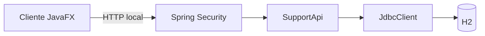

# Seguridad de APIs en una mesa de soporte

**Proyecto individual · Arquitectura de Software · Actualizado el 26 de noviembre de 2026**

## 1. Introducción

### Descripción general y objetivo

**Mesa de Soporte** es una aplicación de escritorio para registrar usuarios, abrir tickets y conversar con un agente de soporte. El objetivo del prototipo es demostrar cómo la API autentica al solicitante y comprueba sus permisos para cada operación y cada ticket.

### Alcance y tecnologías

La demostración cubre autenticación, autorización por rol y por recurso, validación de datos, protección de sesión y gestión de avisos en dependencias. Las pruebas automatizadas del 21 de noviembre usaron datos ficticios y H2 en memoria. La demostración del 26 de noviembre añadió evidencias de Postman, Swagger UI, 42Crunch y Wireshark. [Versión de las pruebas iniciales](https://github.com/angelloaroni/SeguridadApisAroni/tree/f1099fbaa059cbadfd468e23d5e069a7a82fa8bf)

| Tecnología | Uso |
| --- | --- |
| Java 21, JavaFX y Maven | Interfaz de escritorio y construcción de los módulos. |
| Java HttpClient | Solicitudes HTTP y gestión de la cookie de sesión en el cliente. |
| Spring Boot y Spring Security | API REST, autenticación, sesiones y autorización por ruta. |
| Spring JDBC y H2 | Consultas parametrizadas y almacenamiento de cuentas, tickets y mensajes. |
| Springdoc | Generación de OpenAPI y visualización en Swagger UI. |

## 2. Problema

Una mesa de soporte recibe datos de cuenta y conversaciones privadas. Tener una cuenta válida permite entrar al sistema, pero el servidor todavía debe comprobar si esa persona puede ver un ticket concreto o realizar una acción reservada para cierto rol. Además, el proyecto incorpora dependencias de terceros cuyos avisos deben revisarse a medida que se publican.

| Escenario | Resultado esperado |
| --- | --- |
| Consulta sin sesión o con sesión cerrada | Se solicita autenticación. |
| Consulta de un ticket por otro usuario | Se deniega el acceso al ticket. |
| Respuesta del agente asignado | Se agrega el mensaje a la conversación. |
| Actualización de una dependencia con un aviso | Se repite el análisis y se verifica que el flujo siga funcionando. |

## 3. Solución propuesta

1. El usuario se registra, inicia sesión y crea un ticket desde JavaFX.
2. El servidor determina quién es el propietario a partir de la sesión. Si la cuenta de agente ya existe, le asigna el ticket.
3. El propietario y el agente asignado pueden ver y responder la conversación. Otro usuario recibe `404` al solicitar ese ticket.
4. El cierre de sesión invalida la sesión. Los accesos siguientes a rutas privadas requieren iniciar sesión de nuevo.

## 4. Arquitectura del sistema



El proyecto sigue una arquitectura cliente-servidor. El cliente de escritorio está en `frontend/` y la API REST monolítica de Spring Boot está en `backend/`. Spring Security verifica la sesión, el token CSRF y los permisos por ruta. `SupportApi` concentra las reglas de negocio y las consultas SQL. `JdbcClient` ejecuta esas consultas contra H2.

La separación cliente-servidor ubica la decisión de acceso en la API y permite comprobar el mismo comportamiento desde JavaFX o Postman. H2 funciona en modo archivo al ejecutar el proyecto y en memoria durante las pruebas automatizadas.

| Componente | Responsabilidad |
| --- | --- |
| `SupportClient.java` | Gestiona las pantallas de registro, login, perfil, tickets y conversación. Actualiza la interfaz al concluir las peticiones en segundo plano. |
| `api/ApiClient.java` | Envía solicitudes HTTP, conserva las cookies en memoria y obtiene un token CSRF antes de cada escritura. |
| `SecurityConfig.java` | Configura el login, el logout, el acceso por ruta, BCrypt y la cuenta de soporte de la demo. |
| `SupportApi.java` | Valida los datos, determina el dueño a partir de la sesión y consulta o guarda tickets y mensajes. |
| `schema.sql` | Crea las tablas, sus claves y relaciones. |

[Cliente JavaFX](frontend/src/main/java/demo/client/SupportClient.java) · [Cliente HTTP](frontend/src/main/java/demo/client/api/ApiClient.java) · [Configuración de seguridad](backend/src/main/java/demo/support/SecurityConfig.java) · [Controlador](backend/src/main/java/demo/support/SupportApi.java) · [Esquema SQL](backend/src/main/resources/schema.sql)

## 5. Diseño e implementación

### Controles de seguridad

| Control | Implementación |
| --- | --- |
| Contraseñas | Hash BCrypt con factor de costo 12. |
| Sesión | Cookie `JSESSIONID` con `HttpOnly` y `SameSite=Strict`. Se configura una expiración por inactividad de 20 minutos. |
| Autorización por rol | La creación de tickets requiere el rol `USER`. |
| Autorización por recurso | La API filtra los tickets por propietario o agente asignado. |
| Validación | Los DTO definen campos, tipos y límites. El perfil permite editar el nombre visible. |
| CSRF | El cliente obtiene un token asociado a la sesión para las operaciones de escritura. |
| Transporte | HTTP de desarrollo en `127.0.0.1`. Para una red externa, el despliegue requiere HTTPS y una cookie con el atributo `Secure`. |

### Cómo se establece la sesión

1. El cliente obtiene el token con `GET /api/csrf` y conserva la cookie que identifica la sesión.
2. Envía `username` y `password` en `POST /api/login` con `application/x-www-form-urlencoded`. Envía también el token CSRF con el nombre de encabezado devuelto por la API.
3. Spring Security comprueba la contraseña contra el hash de la cuenta. Si el login devuelve `204`, el cliente conserva la cookie de sesión vigente para las solicitudes siguientes.
4. En `GET /api/profile`, Spring Security recupera la identidad de la sesión. El perfil se busca mediante el usuario autenticado y devuelve únicamente `username`, `displayName` y `role`.
5. Para cerrar sesión, el cliente obtiene un token CSRF vigente y lo envía a `POST /api/logout`. El servidor invalida la sesión y elimina la cookie.

En JavaFX, el mismo cliente HTTP obtiene el token y envía la escritura. Su `CookieManager` conserva la sesión entre ambas solicitudes.

```java
private JsonNode mutate(String method, String path, String contentType, String data)
        throws IOException, InterruptedException {
    JsonNode csrf = get("/csrf");
    return send(request(path).header(csrf.get("headerName").asText(), csrf.get("token").asText())
            .header("Content-Type", contentType)
            .method(method, HttpRequest.BodyPublishers.ofString(data)));
}
```

[Implementación del cliente HTTP](frontend/src/main/java/demo/client/api/ApiClient.java)

### Cómo se autoriza cada ticket

La creación exige el rol `USER`. El backend usa el nombre de usuario de la sesión como propietario y, si ya existe la cuenta de soporte, asigna el ticket al agente. La creación del ticket y el primer mensaje comparten una transacción. Para leer o responder un ticket existente, la consulta de autorización exige que el ID coincida y que la identidad de la sesión sea la del dueño o la del agente asignado.

```java
private Ticket visibleTicket(long id, Principal user) {
    return db.sql("SELECT * FROM tickets WHERE id = ? AND (owner = ? OR agent = ?)")
            .params(id, user.getName(), user.getName()).query(Ticket.class)
            .optional().orElseThrow(() -> new ResponseStatusException(HttpStatus.NOT_FOUND));
}
```

La misma operación se invoca antes de cargar la conversación y antes de guardar una respuesta. El `404` es común a un ticket inexistente y a uno fuera del alcance del usuario autenticado. En el listado, la API también filtra por propietario o agente, de modo que solo devuelve los tickets visibles para esa cuenta. [Autorización de tickets en el controlador](backend/src/main/java/demo/support/SupportApi.java)

### Validación de datos

El registro guarda el rol `USER` y un hash BCrypt. El perfil solo admite `displayName` para actualizar. Los DTO limitan el nombre visible a 80 caracteres, el asunto a 120 y el mensaje a 2 000. La configuración de Jackson rechaza propiedades de entrada ajenas al DTO. Las restricciones de la base complementan la validación y vinculan cada ticket y mensaje con las cuentas correspondientes. [DTO y registro](backend/src/main/java/demo/support/SupportApi.java) · [Configuración de Jackson](backend/src/main/resources/application.properties)

### Modelo de datos

| Tabla | Responsabilidad |
| --- | --- |
| `accounts` | Guarda el nombre de usuario, el nombre visible, el hash de contraseña y el rol. |
| `tickets` | Guarda el asunto, el propietario y el agente asignado. |
| `messages` | Vincula cada mensaje con su ticket, autor y fecha de creación. |

### API REST

| Método y ruta | Regla de acceso |
| --- | --- |
| `GET /api/csrf` | Emite el token CSRF para la sesión. |
| `POST /api/register`, `POST /api/login` | Rutas públicas que requieren token CSRF. |
| `POST /api/logout` | Recibe el token CSRF e invalida la sesión. |
| `GET /api/profile`, `PATCH /api/profile` | Devuelven o actualizan el perfil de la sesión activa. |
| `GET /api/tickets` | Devuelve los tickets del propietario o asignados al agente. |
| `POST /api/tickets` | Crea un ticket con el rol `USER`. |
| `GET /api/tickets/{id}`, `POST /api/tickets/{id}/messages` | Requieren ser el propietario o el agente asignado. |

## 6. Demostración

1. Con JDK 21, abre las dos carpetas como proyectos Maven en NetBeans. Ejecuta `spring-boot:run` en el backend y `javafx:run` en el frontend. Para la demo con agente, configura `SUPPORT_AGENT_PASSWORD` antes de crear el primer ticket. [Guía de ejecución](README.md)
2. Registra dos cuentas ficticias. Crea un ticket con la primera, abre la lista con la segunda y comprueba que su lista no contiene el ticket de la primera.
3. Entra como `agente`, responde y vuelve a la primera cuenta para ver la conversación actualizada.
4. Presenta el caso de Commons Lang como un ciclo de gestión, desde el descubrimiento del aviso hasta la actualización y la verificación posterior.

Con el backend en ejecución, abre Swagger UI para mostrar el inventario de rutas. El contrato JSON se genera en `/v3/api-docs` y publica como servidor la dirección local de la demo. El login y el logout los procesan filtros de Spring Security, por eso se describen en el README y quedan fuera del listado generado para `SupportApi`. [Swagger UI local](http://127.0.0.1:8080/swagger-ui.html) · [OpenAPI local](http://127.0.0.1:8080/v3/api-docs) · [Guía de presentación](docs/GUIA-DE-DEMO.pdf)

## 7. Resultados

| Herramienta | Estado y alcance |
| --- | --- |
| Cliente HTTP de Python | **Ejecutado.** 21 comprobaciones de la API pasaron con tres sesiones independientes. Se validaron códigos HTTP, campos de respuesta y atributos de la cookie. |
| curl | **Ejecutado.** Una solicitud local a `GET /api/profile` mostró una conexión a `127.0.0.1` por HTTP/1.1 y recibió `401` sin sesión. |
| Redocly CLI 2.82.0 | **Ejecutado.** Analizó el OpenAPI 3.1 generado por Springdoc con el conjunto de reglas `recommended`. Reportó 10 errores y 9 advertencias. |
| OSV Scanner 2.7.1 | **Ejecutado.** Consultó avisos conocidos para las dependencias de ejecución de ambos módulos, incluidas las transitivas resueltas por Maven. |
| TShark 4.6.4 (Wireshark) | **Ejecutado.** Capturó dos intercambios HTTP en loopback dentro de un contenedor aislado. El resultado conservó método, ruta y estado. |
| Postman | **Utilizado en la demostración.** La colección organiza solicitudes para obtener CSRF, iniciar sesión, consultar perfil y tickets y cerrar sesión con dos cuentas distintas. La captura disponible muestra un perfil que recibió `401`. |
| 42Crunch | **Ejecutado en el entorno de la demostración.** La captura de Security Audit Report muestra `9/100` y puertas de calidad fallidas. |
| Wireshark | **Ejecutado en el entorno de la demostración.** La captura del adaptador loopback muestra búsquedas de tickets y de perfil con respuestas HTTP `401`. |
| Salt Security | **Pendiente.** La evaluación de monitoreo en ejecución requiere una instancia de Salt y una fuente de tráfico integrada. El entorno carecía de esa integración. |

### Postman y códigos de respuesta

La colección usa Postman como cliente independiente de JavaFX. Para verificar autenticación, se compara el resultado de `GET /api/profile` antes y después del login. Para verificar acceso a tickets, se usa el ID de un ticket de demostración propio y se comprueba la respuesta esperada tras cerrar la sesión e iniciar con la otra cuenta.

| Paso de la colección | Qué comprueba | Resultado esperado |
| --- | --- | --- |
| Perfil sin sesión | Una solicitud sin autenticación se rechaza. | `401` |
| Obtener CSRF → Login propietario A | La sesión se inicia con las credenciales de A. | `200` → `204` |
| Perfil autenticado A → Ticket propio | A puede ver su perfil y su ticket. | `200` → `200` |
| Renovar CSRF → Logout A | La sesión de A se invalida. | `200` → `204` |
| Obtener CSRF → Login usuario B → Ticket de A | B inicia sesión, pero el ticket de A queda fuera de su alcance. | `200` → `204` → `404` |

En la captura de Postman, la solicitud `04 Perfil autenticado — 200` devolvió **`401 Unauthorized`** y falló su validación de estado. El título indica el resultado esperado. Para diagnosticar ese caso, se revisa primero que el login anterior haya devuelto `204`, luego que Postman haya conservado la cookie `JSESSIONID` actualizada y que la envíe al mismo host antes del cierre de sesión. Un `403` durante el login lleva a revisar el token CSRF y su cookie asociada.

### Comprobaciones funcionales automatizadas

| Caso | Evidencia observada |
| --- | --- |
| Autenticación | Perfil sin sesión `401`, registro de ambos usuarios `201`, nombre duplicado `409`, contraseña incorrecta `401` y tres inicios de sesión válidos `204`. |
| Sesión y CSRF | `HttpOnly` y `SameSite=Strict` presentes en la cookie del inicio de sesión. Registro sin token `403`. Cierre de sesión `204` y acceso posterior al perfil `401`. |
| Perfil | Consulta y actualización del nombre `200`. La consulta solo devolvió usuario, nombre visible y rol. Un cuerpo con un campo ajeno al esquema recibió `400`. |
| Autorización | Creación y asignación del ticket `201`, lectura del propietario `200`, lista vacía para el segundo usuario `200` y consulta del ticket ajeno `404`. Crear un ticket con rol agente recibió `403`. |
| Mensajería | El agente asignado respondió con `201`. La propietaria volvió a consultar y vio los dos mensajes con sus respectivos autores `200`. |

### Observación del tráfico con Wireshark

La captura gráfica de la demostración usó el adaptador de loopback con el filtro `tcp.port == 8080`. En el panel de paquetes se ven dos intercambios HTTP con origen y destino `127.0.0.1`. Las rutas siguientes conservan la escritura que se ve en la captura.

```text
GET /api/tickets/ HTTP/1.1  →  HTTP/1.1 401
GET /api/profile HTTP/1.1   →  HTTP/1.1 401
```

El `401` confirma que el servidor rechazó ambas solicitudes sin una sesión reconocida. El endpoint que publica el contrato para el listado es `GET /api/tickets`. Como el filtro de seguridad puede responder antes de alcanzar el controlador, el `401` de la captura por sí solo no permite saber si la variante con barra final coincide con una ruta.

En una prueba separada, TShark 4.6.4 capturó los siguientes resultados en un contenedor aislado.

| Solicitud observada | Respuesta capturada |
| --- | --- |
| `GET /api/profile` sin sesión | `401` |
| `GET /v3/api-docs` | `200` |

La captura de TShark confirmó que se podían leer el método, la ruta y el estado HTTP en el transporte local de desarrollo. La prueba usó dos peticiones sin credenciales. Para un despliegue en red, la configuración de HTTPS requiere una verificación aparte. [Manual de TShark](https://www.wireshark.org/docs/man-pages/tshark.html)

### Auditoría del contrato con 42Crunch

El informe de **Security Audit Report** visible en la captura registra estos resultados.

| Indicador | Resultado informado |
| --- | --- |
| Puntuación global | **9/100** |
| Seguridad | **0/30** |
| Validación de datos | **9/70** |
| Puertas de calidad | **Fallidas** |

| Hallazgo visible | Apariciones | Qué revisar |
| --- | ---: | --- |
| Texto de respuesta sin patrón | 11 | Documentar formatos solo en campos que tengan una estructura definida, como el nombre de usuario. |
| Texto de respuesta sin longitud máxima | 11 | Declarar en el contrato los límites que aplica el backend o el esquema de datos. |
| Texto de solicitud sin patrón | 9 | Revisar cada campo. Los mensajes de texto libre necesitan límites adecuados y los identificadores estructurados pueden documentar un patrón. |
| Operación sin respuesta `406` documentada | 8 | Verificar cuándo devuelve Spring un error de negociación de contenido y reflejarlo donde corresponda. |
| Credencial en cookie sobre HTTP | 6 | Revisar la configuración HTTPS y el atributo `Secure` de la cookie antes de publicar. |

El hallazgo de la cookie parte de cómo se documenta la sesión en OpenAPI. Springdoc declara el esquema `session` como `apiKey` ubicada en la cookie `JSESSIONID`. El valor de esa cookie identifica una sesión del servidor. Como el contrato de la demo anuncia `http://127.0.0.1:8080`, 42Crunch identifica el transporte de esa credencial sobre HTTP. El resultado de la auditoría mide el contrato e indica puntos de mejora. Los controles de identidad y autorización se comprueban con solicitudes a la API en ejecución.

```java
@SecurityScheme(name = "session", type = SecuritySchemeType.APIKEY,
        in = SecuritySchemeIn.COOKIE, paramName = "JSESSIONID")
```

[Declaración del esquema](backend/src/main/java/demo/support/SupportApplication.java) · [Documentación de Security Audit de 42Crunch](https://docs.42crunch.com/latest/content/concepts/api_contract_security_audit.htm)

### Revisión complementaria con Redocly

Ocho operaciones carecían de resumen y ocho omitían documentar respuestas `4xx`. Además, `GET /api/csrf` y `POST /api/register` carecían de una declaración explícita de seguridad en el contrato. Son rutas públicas por diseño y la prueba de registro confirmó que la escritura sigue exigiendo CSRF. La advertencia restante corresponde a los metadatos de licencia. El inicio y el cierre de sesión se implementan mediante filtros de Spring Security y actualmente se describen en el README.

La mejora propuesta es documentar las respuestas `401`, `403`, `404` o `400` donde correspondan y declarar explícitamente cuáles operaciones son públicas. Esto permite comparar el contrato con lo que devuelve el servidor. [Redocly CLI](https://github.com/Redocly/redocly-cli)

### Gestión de dependencias

| Módulo | Dependencias revisadas | Dependencias con avisos | Avisos distintos dentro del módulo |
| --- | ---: | ---: | ---: |
| Backend | 62 | 12 | 54 |
| Frontend | 9 | 2 | 19 |

Los 19 avisos del frontend también aparecen en el backend para versiones de Jackson. En conjunto hubo **54 identificadores únicos**. Los resultados vinculan avisos publicados con componentes y versiones. Determinar su impacto en el proyecto requiere revisar la configuración y las funciones utilizadas. [OSV Scanner](https://github.com/google/osv-scanner)

**Ejemplo de corrección verificada.** El backend resolvía Apache Commons Lang `3.17.0`, versión afectada por `CVE-2025-48924`. En una copia temporal se fijó `3.18.0`, la primera versión corregida según el aviso. Se recompiló el backend y se confirmó que ese JAR era la única diferencia en el inventario Maven. Al repetir el análisis, el aviso desapareció y el total del backend bajó de 54 a 53. Las 21 comprobaciones funcionales volvieron a pasar. La actualización se ensayó en la copia temporal. [Aviso GHSA-j288-q9x7-2f5v](https://github.com/advisories/GHSA-j288-q9x7-2f5v)

## 8. Conclusiones

La ejecución comprobó que la API aplica el control de acceso por usuario, rol y ticket, y que el cierre de sesión y el requisito de CSRF se cumplen en los casos probados. Postman permitió revisar el estado de cada solicitud. La captura de Wireshark mostró los intercambios en HTTP local y la auditoría de 42Crunch identificó carencias del contrato. Las prioridades son alinear OpenAPI con la validación real, probar HTTPS y la cookie `Secure` para un despliegue fuera de loopback, y revisar los avisos pendientes de las dependencias.

## Repositorios y referencias

- Proyecto individual con ambos módulos. [SeguridadApisAroni](https://github.com/angelloaroni/SeguridadApisAroni) · [Frontend JavaFX](https://github.com/angelloaroni/SeguridadApisAroni/tree/main/frontend) · [Backend Spring Boot](https://github.com/angelloaroni/SeguridadApisAroni/tree/main/backend)
- Referencia de estructura, sección **0.9, Temas individuales parte 2**. Se utilizó la copia adjunta `0.9.5.md` de AegisSOAR. El enlace directo al repositorio devolvió `404` con el acceso disponible. [Repositorio del Grupo 7](https://github.com/ulima-arqsoft/arqui261-grupo7/tree/main)
- Referencia de autorización por recurso y por función. [OWASP API Security Top 10](https://owasp.org/API-Security/editions/2023/en/0x11-t10/)
- Herramientas de la demostración. [Postman](https://www.postman.com/) · [42Crunch](https://42crunch.com/) · [Wireshark](https://www.wireshark.org/docs/)

## Enlaces de entrega

- Link Youtube: pendiente
- Link Repositorio: pendiente
- Link Aporte del grupo: pendiente
